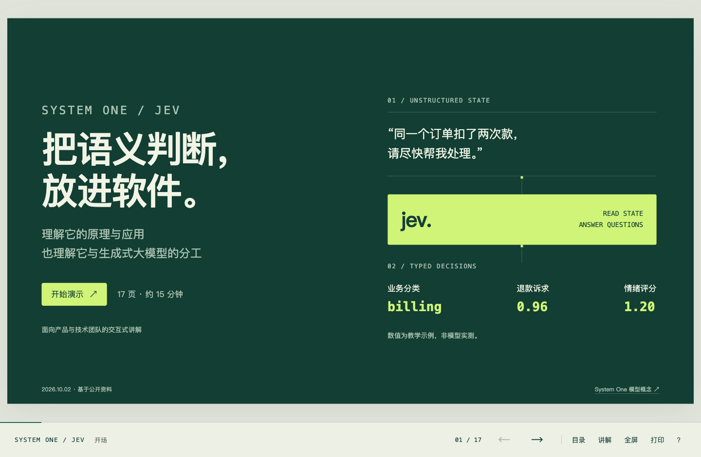

# Forest HTML Slides

一个用于制作交互式 HTML 演示文稿的 AI skill。将文章、技术概念或产品方案整理成可讲解的幻灯片，保持墨绿、米白与青柠点缀的视觉风格。

技能入口是仓库根目录的 [SKILL.md](SKILL.md)。仓库同时提供设计规范、可运行模板和完整示例，方便 Agent 在新主题中复用。



## 适合用来做什么

- 把文章或 Markdown 笔记改编成课程演示。
- 用过程图、对比表和逐步播放讲清技术原理。
- 为产品介绍、方案比较和团队分享制作统一风格的幻灯片。
- 加入有实际状态变化的交互，例如切换案例、调整参数、观察分支结果。

默认输出为单个 HTML 文件，内嵌样式与脚本。播放不依赖 CDN、在线字体或模型 API，也不需要安装前端依赖或运行构建命令。

## 快速使用

### 在当前项目中使用

让 Agent 读取本仓库的 `SKILL.md`，再提供主题或材料。例如：

```text
读取本仓库的 SKILL.md，使用这套风格，将我提供的文章制作成 HTML 演示文稿。
听众是产品与技术团队，预计讲解 15 分钟，加入适合内容的交互，输出到 output/。
```

页数、章节和交互类型由任务决定，不固定套用示例的 17 页结构。

### 安装为 Codex 个人 skill

将仓库克隆到个人技能目录：

```sh
git clone https://github.com/tianchangNorth/forest-html-slides.git \
  "${CODEX_HOME:-$HOME/.codex}/skills/forest-html-slides"
```

安装后，在能够发现该技能的会话中调用：

```text
使用 $forest-html-slides，把这份 AI Agent 入门文章制作成适合 20 分钟讲解的演示。
保留核心观点，加入流程演示，并附逐页讲解备注与资料来源。
```

也可以交给其他能够读取 `SKILL.md` 的 Agent 使用；自动发现和调用方式取决于宿主。只克隆到普通项目目录时，可按上面的“在当前项目中使用”方式显式读取入口。

## 技能包含什么

| 资源 | 用途 |
| --- | --- |
| [SKILL.md](SKILL.md) | 使用场景、内容组织、风格约束与交付检查 |
| [设计规范](references/design-system.md) | 配色、字体、画布、布局、移动端与动效 |
| [编写与交互约定](references/authoring.md) | 内容数据结构、播放器和页内交互的扩展方式 |
| [HTML 骨架](assets/starter.html) | 六个可替换的版式样本与通用播放器 |
| [完整风格参考](assets/reference.html) | 原始演示，供排版和交互实现参考 |
| [风格总览](assets/contact-sheet.png) | 快速查看整套演示的布局与深浅节奏 |

视觉基准是 1440 × 810 的 16:9 画布，以大标题、宽留白、细分隔线和平面布局组织内容。窄屏改为单栏滚动，避免将整页缩成难以阅读的小图。

模板内置翻页、目录、逐页讲解、全屏、URL 页码、触摸操作和打印样式。生成新演示时，Agent 复制模板并替换内容，按需增加交互。

## 示例

下载或克隆仓库后，用浏览器打开对应 HTML 文件即可播放。GitHub 文件页面展示的是源码。

| 演示 | 页数 | 内容 |
| --- | --- | --- |
| [System One / Jev](examples/system-one-jev.html) | 17 | 判断原语、模型对比、工单分流、概率与费用估算 |
| [第零课：AI Agent 概念演进](examples/ai-agent-evolution.html) | 18 | 工具调用、MCP、Skills、Agent 循环与代码检索 |

示例中的外部论断、价格与产品能力有各自的资料日期；教学数据和动画不等于实测。复用时应替换为新主题的内容与依据。

## 播放操作

| 操作 | 功能 |
| --- | --- |
| `←` / `→`、`PageUp` / `PageDown` | 上一页 / 下一页 |
| 空格 | 下一页 |
| `Home` / `End` | 首尾跳转 |
| `O` | 目录 |
| `N` | 当前页讲解 |
| `F` | 全屏切换，受浏览器支持情况影响 |
| `?` / `Esc` | 帮助 / 关闭弹层 |
| 手机横向轻扫 | 翻页 |
| 工具栏“打印” | 打印或通过浏览器保存 PDF |

打印建议开启背景图形。PDF 是静态页面，不包含可操作交互和讲解弹层。

## 仓库结构

```text
forest-html-slides/
├── SKILL.md
├── README.md
├── agents/
│   └── openai.yaml
├── assets/
│   ├── starter.html
│   ├── reference.html
│   ├── preview.png
│   └── contact-sheet.png
├── references/
│   ├── design-system.md
│   └── authoring.md
└── examples/
    ├── system-one-jev.html
    └── ai-agent-evolution.html
```

`agents/openai.yaml` 提供技能的显示名称、说明与默认提示。技能所需的路径均相对仓库根目录，可整体移动。

## 扩展与维护

- 调整视觉规则时，同步检查设计规范和 HTML 骨架。
- 新增交互时，按页面 ID 注册行为，处理重置、离页清理、减少动态效果与打印状态。
- 内容与补充讲解分别放入 `slides` 和 `notes`；来源通过 `sources` 与 `refs` 关联。
- 新主题从模板复制开始，不直接覆盖原始风格参考。
- 交付前检查桌面与手机排版、导航、交互边界、离线加载和打印结果。

建议把日常生成的演示与检查产物放入 `output/`，该目录不纳入版本控制。需要长期保留的代表性成品可以整理进 `examples/`。
